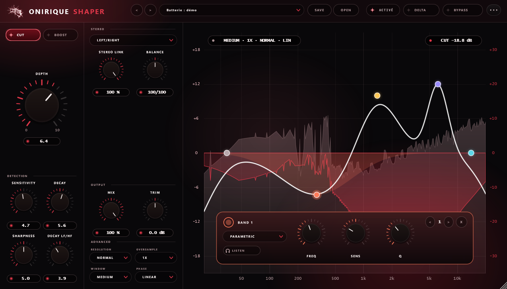

# Onirique BrumeBox (prototype)

Repère les attaques fréquence par fréquence (le principe de spiff : chaque bin
comparé à sa propre moyenne récente, en dB, donc indépendant du niveau), puis :

- les **attaques** sont coupées ou poussées (**Attaque**), et frappent une boîte
  de **résonateurs accordés** sur un accord (**Note**, **Accord**, **Résonance**,
  **Durée reso**, **Éclat**) ;
- **tout le son** laisse une **brume** spectrale qui s'éteint lentement
  (**Brume**, **Durée brume**), dont la phase se dissout (**Flou**).

Même architecture que ResoBox : le moteur (`Source/dsp`) ne dépend pas de JUCE
et se teste hors ligne ; la FFT est celle de ResoBox.

## État

| Partie | État |
|---|---|
| Moteur (STFT 2048 / hop 512, détection, résonateurs, brume) | fait, testé hors ligne |
| Plugin VST3 / AU, paramètres automatisables | compile sur Mac (universel arm64 + x86_64) |
| Licence ONIRIQUE (`brumebox`) | branchée ; fiche CENTRAL « fondateurs seulement », 1.0.1 Mac en ligne |
| Interface | faite (`snapshot.png`), vérifiée sur capture (`brumebox_snapshot`) |
| Version Windows | non compilée |
| Écoute dans un DAW | **pas encore faite** |

Latence : 2048 échantillons à 44,1/48 kHz (déclarée à l'hôte).

## Construire

```bash
cmake -B build -G Ninja -DCMAKE_BUILD_TYPE=Release -DBRUMEBOX_JUCE_DIR=../ResoBox/JUCE
cmake --build build --parallel
ctest --test-dir build --output-on-failure
```

Le test écrit `build/brumebox_sec.wav` et `build/brumebox_reve.wav` pour écouter
l'effet sans DAW.

## Interface



- **En-tête** : la pastille de licence, DELTA (n'écouter que ce qui change), BYPASS (latence gardée).
- **Première colonne — les attaques** : CUT / BOOST, DEPTH, puis la détection (SENSIBILITÉ, RETOUR, TILT) et MIX.
- **Deuxième colonne — ce qui en naît** : la note et l'accord, RÉSO, sa DURÉE et son ÉCLAT ; puis la BRUME, sa DURÉE et le FLOU ; OUT.
- **L'écran** : le spectre qui entre ; en rouge ce qui est coupé des attaques (en violet s'il est poussé) ;
  une étoile par note de l'accord ; la courbe de sensibilité et ses cinq bandes. Un point se glisse
  (fréquence et sensibilité), la molette règle sa largeur, un double clic l'éteint ; un clic l'ouvre dans
  son panneau (forme, FREQ, SENS, Q). Une bande à −12 dB ne laisse plus rien traiter à cet endroit.

Laisser le curseur deux secondes sur un contrôle affiche sa description, en français.

Capture sans hôte : `cmake --build build --target brumebox_snapshot`, puis
`build/brumebox_snapshot snapshot.png [largeur hauteur] [--boost] [--tip x y]`.

## Réglages

| Réglage | Rôle |
|---|---|
| Sensibilité | 0..10 : seuil de détection, de 14 dB à 2 dB au-dessus de la moyenne du bin |
| Retour | temps de retour de chaque bin après une attaque |
| Tilt | aigus (> 0) ou graves (< 0) qui retombent plus lentement |
| Cut / Boost, Depth | les attaques détectées baissées (jusqu'à −24 dB) ou poussées (jusqu'à +12 dB) |
| Bandes 1 à 5 | où la détection travaille plus (+) ou moins (−) ; forme, fréquence, sensibilité, Q |
| Résonance | quantité de résonateurs frappés par les attaques |
| Durée reso | T60 des résonateurs |
| Note / Accord | accord des 12 modes (octaves, quintes, mineur 9, majeur 7, sus2, lydien) |
| Éclat | modes aigus courts et doux, ou longs et brillants |
| Brume / Durée brume | niveau et T60 de la traîne spectrale |
| Flou | la phase de la brume et du son part au hasard |
| Mix / Sortie | sec/traité, gain de sortie |
